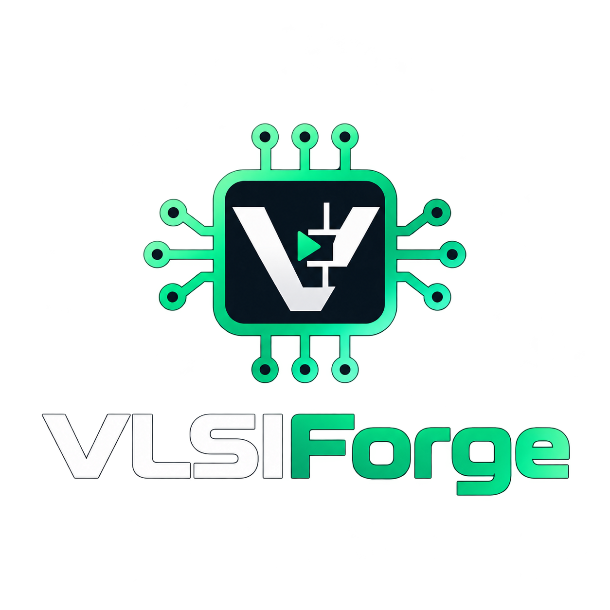
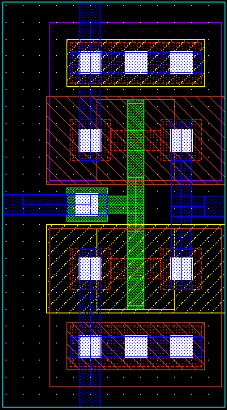
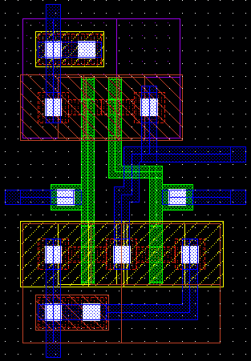
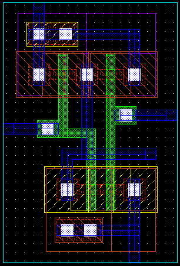

<div align="center">



### Analog IC design in the browser — schematic to silicon, no installation.

[](https://dedeep-vlsi-fe-engg.github.io/VLSIForge/)
[](https://dedeep-vlsi-fe-engg.github.io/BitForge/)


**[Open VLSIForge](https://dedeep-vlsi-fe-engg.github.io/VLSIForge/)** · **[BitForge](https://dedeep-vlsi-fe-engg.github.io/BitForge/)** · **[FPGAForge](https://dedeep-vlsi-fe-engg.github.io/FPGAForge/)**

</div>

---

## Overview

**VLSIForge** is a browser-based analog IC design environment modelled on the industry-standard Cadence® Virtuoso® custom IC flow used in university VLSI labs. It lets students and engineers practise the complete front-to-back analog flow — **schematic → symbol → simulation → layout → DRC → LVS → parasitic extraction → post-layout simulation → GDSII** — from any modern browser, with nothing to install.

The workflow, menus, forms and bindkeys follow the familiar CIC analog lab flow, so lab manuals translate step by step.

<div align="center">
&nbsp;&nbsp;
&nbsp;&nbsp;

</div>

---

## Features

### Design entry
- **Library Manager** with libraries, cells and views; create libraries attached to a technology kit
- **Schematic Editor** — instances, wires with automatic L-routing, pins, wire labels, notes, rotate / mirror, properties, undo / redo, check & save
- **Symbol generation** from a schematic (rectangle, amplifier, inverter shapes) and a **Symbol Editor**
- Hierarchical designs with descend / ascend

### Simulation (Spectre-style engine, ADE L)
| Analysis | Description |
|---|---|
| `dc` | Operating point and sweeps of a source, design variable or temperature |
| `tran` | Transient with adaptive time-step (conservative / moderate / liberal) |
| `ac` | Small-signal frequency response |
| `noise` | Output / input-referred noise with per-device noise summary |
| `xf` | Transfer functions from every source to an output |
| `pz` | Pole-zero analysis with Q and right-half-plane warnings |
| `sens` | DC sensitivity ranking of R, W, L, Vth and sources |

Plus **Parametric Analysis**, **Monte Carlo** (process + mismatch), **Corners** (tt / ff / ss / fs / sf × temperature), process sections, design variables, saved states and DC operating-point annotation on the schematic.

### Results
- **Waveform viewer** — tabs and strips, split view, zoom, log axes, vertical / horizontal / point / delta markers, PNG and CSV export
- **Results Browser** for all signals and operating points
- **Waveform Calculator** — `delay`, `bandwidth`, `cross`, `riseTime`, `fallTime`, `slewRate`, `dB20`, `phase`, `phaseMargin`, `gainMargin`, `unityGainFreq`, `value`, `ymax`, `average`, `rms` and more

### Physical design & verification
- **Layout Editor (Layout XL style)** — Layer Select Window, rectangles, paths, vias / contacts, parameterized transistor cells, pins, labels, stretch, ruler, guard rings
- **Generate All From Source** with **flight lines** for unrouted nets
- **DRC** using the gpdk090 design-rule values (width, spacing, enclosure, extension, area), with an Error Layer Window
- **LVS** — extraction, parallel-finger merging, graph matching and a plain-language "probable cause" report
- **RCX** — coupling / ground capacitance and contact resistance into an `av_extracted` view
- **Config views & Hierarchy Editor** to simulate with parasitics (post-layout simulation)
- **GDSII stream out / stream in**

### Scripting
- **CIW** command line and **SKILL IDE**
- **SKILL** interpreter (C-style and Lisp-style syntax, `procedure`, `let`, `foreach`, `~>` property access)
- Database API: `dbOpenCellViewByType`, `dbCreateRect`, `schCreateInst`, `schCreateWire`, `dbSave`, …
- **OCEAN**: `design`, `analysis`, `desVar`, `run`, `selectResult`, `v`, `i`, `plot`, `ocnPrint`, `paramRun`, …
- **Python** (subset) with the same OCEAN, database and calculator functions

### Technology kits
| Kit | Node | Devices |
|---|---|---|
| `gpdk045` | 45 nm | `nmos1v`, `pmos1v`, `nmos2v`, `pmos2v` |
| `gpdk090` | 90 nm | `nmos1v`, `pmos1v`, `nmos2v`, `pmos2v` |
| `gpdk120` | 120 nm (generic) | `nmos`, `pmos` |
| `gpdk180` | 180 nm | `nmos`, `pmos` |

Also included: **analogLib** (DC, pulse, sine and PWL voltage / current sources, R, L, C, VCVS, VCCS, diode, ground and supplies) and **basic**.

---

## Accounts & your data

| | |
|---|---|
| **Sign-in** | Free accounts with email and password (Firebase Authentication), email verification and password reset |
| **What the server stores** | Only your name, email and sign-in times |
| **Where your designs live** | In a **workspace folder on your own PC** that you choose after signing in |
| **Auto-save** | Every library, cell view, schematic, layout, ADE setup, script and waveform is saved automatically |
| **Coming back** | Choose the same folder (one click) and your previous work reopens |
| **Reset** | *Account menu → Reset my workspace* deletes all your work and starts fresh |

> Folder auto-save requires **Google Chrome** or **Microsoft Edge** on a desktop / laptop. Other browsers keep work in browser storage, with manual export.

---

## Getting started

1. Open **https://dedeep-vlsi-fe-engg.github.io/VLSIForge/**
2. **Create a free account** (or continue without one)
3. Choose a **workspace folder** on your PC
4. On the welcome screen, select **Open the finished lab designs** to load ready-made examples — inverter and CS amplifier with test benches, ADE states and a DRC/LVS-clean layout
5. Open `Inverter_Test` → **Launch → ADE L** → **Session → Load State** → **Run**

New to the flow? **Help → Lab walkthrough** maps each lab step to the menus.

---

## Keyboard shortcuts

| Schematic | | Layout | | Waveform | |
|---|---|---|---|---|---|
| `i` | Instance | `r` | Rectangle | `f` | Fit |
| `w` | Wire | `p` | Path | `v` | Vertical marker |
| `p` | Pin | `o` | Via | `h` | Horizontal marker |
| `l` | Wire name | `s` | Stretch | `m` | Point marker |
| `q` | Properties | `k` | Ruler | `a` / `b` | Delta markers |
| `m` / `c` | Move / Copy | `q` | Properties | `Ctrl+E` | Clear markers |
| `r` | Rotate | `Shift+G` | Guard ring | Drag | Zoom box |
| `u` / `Shift+U` | Undo / Redo | `u` / `Shift+U` | Undo / Redo | Wheel | Zoom |
| `Shift+X` | Check & save | `Ctrl+S` | Save | | |
| `f` / `z` | Fit / Zoom box | `f` / `z` | Fit / Zoom box | | |

The full list is under **Options → Bindkeys**.

---

## Technology stack

- **Frontend:** vanilla JavaScript, HTML5 Canvas, CSS — delivered as a single self-contained `index.html`
- **Simulation:** custom MNA circuit simulator (Newton–Raphson, trapezoidal integration, complex AC solver, adjoint noise, eigenvalue-based pole-zero)
- **Verification:** custom geometry engine for DRC, layout extraction, LVS graph matching and RCX
- **Accounts:** Firebase Authentication + Cloud Firestore (Spark plan)
- **Storage:** File System Access API (user's PC) with browser storage fallback
- **Hosting:** GitHub Pages

---

## Repository structure

```
VLSIForge/
├── index.html          # The complete application
├── firestore.rules     # Firestore security rules (profiles + admin read)
├── README.md
└── assets/             # Logos and screenshots used in this README
```

## Deployment

1. Upload `index.html` to this repository (branch `main`, root folder)
2. **Settings → Pages → Deploy from a branch → `main` / `root`**
3. In the Firebase project: enable **Email/Password** sign-in, add `dedeep-vlsi-fe-engg.github.io` to **Authorized domains**, and publish `firestore.rules`

---

## Limitations (Version 1)

- Device models are **approximate teaching models**, not foundry models
- DRC rules follow the public **gpdk090** values; other kits are scaled from them
- `gpdk120` is a generic kit (Cadence does not ship a 120 nm GPDK)
- PSS, harmonic balance and `stb` analyses are not yet available
- LVS and DRC expect Manhattan geometry with gates fully crossing active
- The Python console supports a subset of the language

---

## Roadmap

Version 2 is being planned. Feedback and suggestions are welcome via the contact below.

---

## Contact

**BitForge** — [dedeep-vlsi-fe-engg.github.io/BitForge](https://dedeep-vlsi-fe-engg.github.io/BitForge/)
Email: [fpgaforgedss@gmail.com](mailto:fpgaforgedss@gmail.com)

---

<div align="center">


**VLSIForge is a BitForge company** · Developed by **DSS with Claude**

<sub>VLSIForge is an independent educational project and is not affiliated with, endorsed by, or sponsored by Cadence Design Systems, Inc. Cadence, Virtuoso, Spectre, Assura and SKILL are trademarks of their respective owners.</sub>

<sub>© 2026 BitForge. All rights reserved.</sub>

</div>
